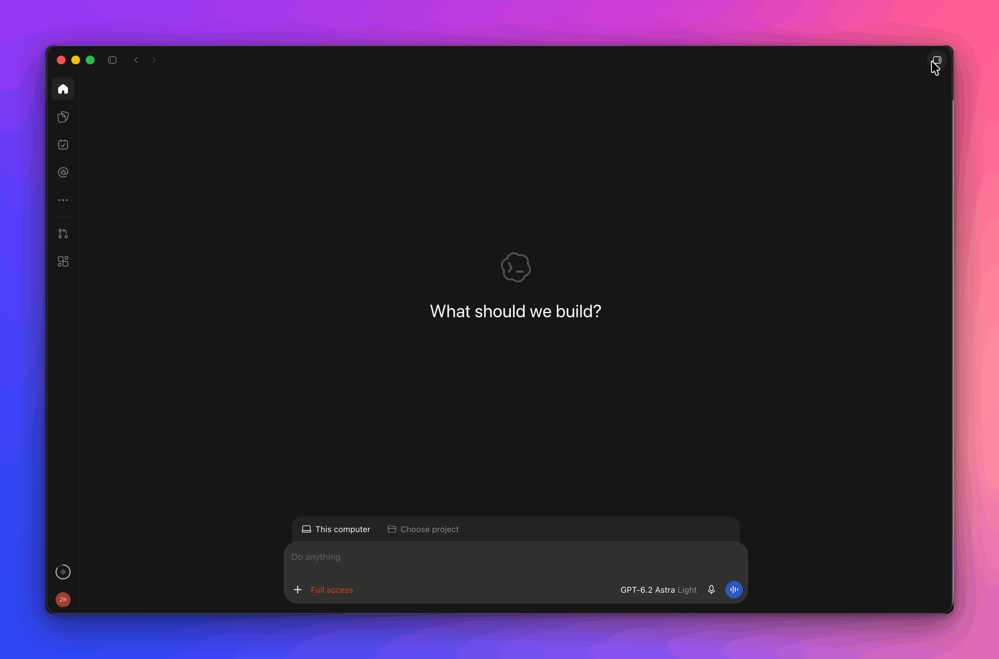
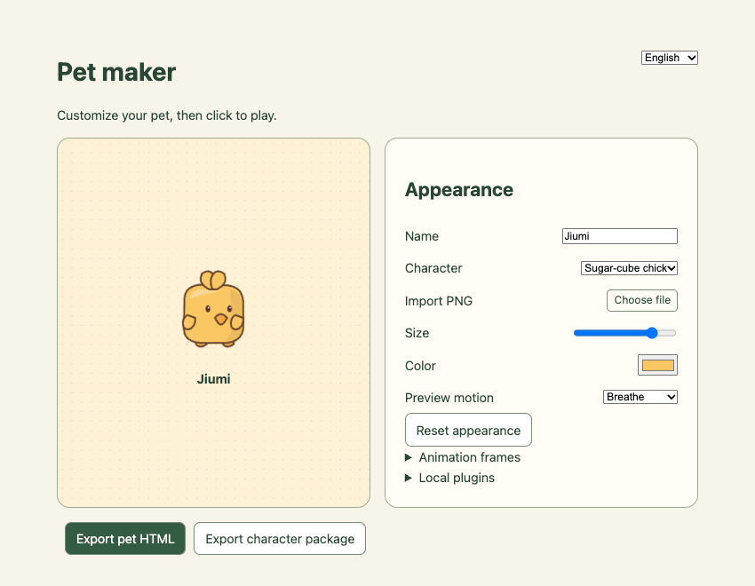

# Jiumi

**English** · [Simplified Chinese](docs/zh-CN/README.zh-CN.md) · [Documentation](docs/README.md)

Jiumi is a lightweight, extensible framework that makes it easy for any agent to build custom desktop pets.

## Tell your agent

```text
Use this skill: https://github.com/r1ckypp/jiumi/tree/main/skill/jiumi-pet
Make me a blue jiumi named Bubble.
```



## What you can customize

- **Your artwork, your pet.** A single transparent PNG is enough to start. Add animation frames for a blink or a wave, change how your pet reacts to touch, or extend its behavior with local plugins.
- **Bring your own agent.** Give the public Skill to the assistant you already use, whether that’s ChatGPT, Claude Code, Doubao Work, Qoder Work, Workbody, or another tool that can follow its instructions. The Skill guides creation, and the finished pet runs independently.
- **One pet across platforms.** Open the HTML edition in a browser on macOS, Windows, or Linux. On macOS, you can also run it as a floating desktop companion. Native support for more platforms and a mobile experience for Android and iOS are on the roadmap.

## Use the local pet maker

1. Unpack the Skill and open `jiumi-pet/maker.html` in your browser. From a source checkout, run the following command at the repository root, then open `dist/maker.html`.

   ```sh
   python3 integrations/local/build.py
   ```

2. Choose a character or import your own transparent PNG, then give your pet a name. Click your pet to stroke it, or hold and drag to pick it up. Release to watch it land.
3. Use the HTML export at the bottom of the maker to save your pet. Open the downloaded file to play. To keep editing the same character later, also export its JSON package.



The source build also produces `dist/jiumi-pet-skill.zip` and `dist/jiumi-local.zip` for compatible plugin hosts. [Skill guide](skill/jiumi-pet/SKILL.md)

Hosted platforms are optional integrations. Your agent creates the pet, and the finished files run on your device.

## Extend Jiumi

Try the bundled focus timer. Expand the local plugins section in the maker and import the timer’s JSON file. Once enabled, the plugin starts a 25-minute timer when it receives an `agent.started` event. The pet saves the deadline. [Example source](examples/focus-timer/index.ts) · [Installable module](examples/modules/focus-timer.json) · [Plugin SDK](docs/spec/plugin-sdk.md)

| If you want to… | Start here |
| --- | --- |
| Create a pet through your assistant | [Skill guide](skill/jiumi-pet/SKILL.md) |
| Connect a tool or map an event to a motion | [Events and feedback](docs/spec/event-feedback.md) |
| Work with a pet package | [Local runtime design](docs/spec/offline-pet.md) · [JSON Schema](docs/spec/contracts.schema.json) |
| Build, test, translate or submit a change | [Contributing](docs/CONTRIBUTING.md) · [Project guidance](AGENTS.md) |

## License

Jiumi's open core and its documentation are distributed under the MIT License. Official character artwork is maintained separately. For third-party art or plugins, check the terms supplied with those files. [MIT License](LICENSE)
