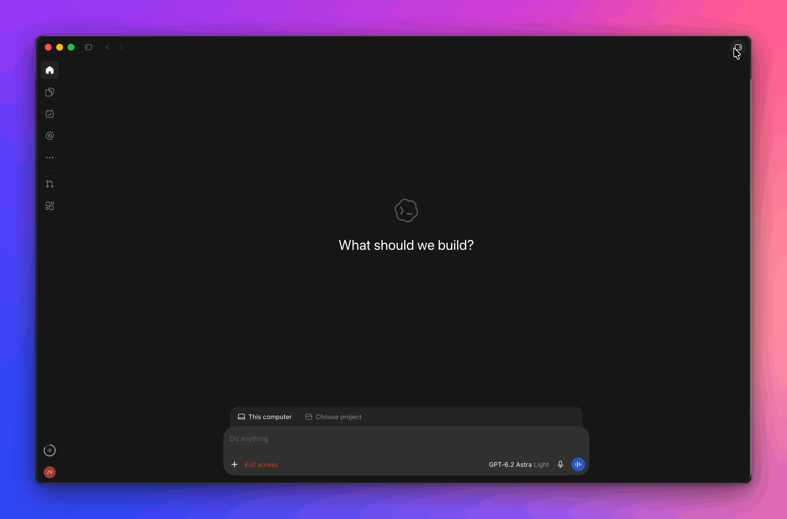

# 啾咪 · Jiumi

[English](../../README.md) · **简体中文** · [文档目录](index.zh-CN.md)

啾咪是一个轻量、可扩展的框架，让任何 Agent 都能轻松创建自定义桌面宠物。

## 告诉你的 Agent

```text
使用这个 Skill：https://github.com/r1ckypp/jiumi/tree/main/skill/jiumi-pet-zh
给我做一只蓝色啾咪，叫泡泡。
```



## 为什么做啾咪

分发软件要打包，使用软件要下载安装。有了 AI，你可以直接告诉它想养一只什么样的桌宠，让它在本机帮你做出来。

啾咪提供轻量、可扩展的模块化框架。素材可以自己画，也可以让 AI 生成。它长什么样、怎么动、什么时候回应你，都由你决定。

## 框架特色

- **从一张图开始，定制到每个动作。** 一张透明 PNG 就能做出第一只宠物。你可以给它画两帧眨眼，让它被摸时挥挥爪子，也可以装上本地插件，为它加上新本领。形象和动作素材都可以由你自己提供。
- **用你习惯的 Agent 来做。** 能读取 Skill 并运行本地脚本的助手可以按说明创建桌宠。各桌面客户端的插件适配进度见[支持矩阵](#桌面-agent-支持矩阵)。
- **同一只宠物，带到不同平台。** 目前可以在 macOS、Windows 和 Linux 的浏览器中打开 HTML 版，在 macOS 上还可以把它变成独立的桌面悬浮宠物。更多平台的原生支持，以及 Android、iOS 的移动体验，将逐步拓展。

## 使用本地桌宠制作器

1. 解压 Skill，在浏览器中打开 `jiumi-pet-zh/maker.html`。如果使用源码，在仓库根目录运行下面的命令，再打开 `dist/maker.html`。

   ```sh
   python3 integrations/local/build.py
   ```

2. 在右上角的语言菜单选择「简体中文」。给方糖小鸡起个名字，或选蓝色小猪、导入自己的透明 PNG。点一下摸摸它，长按拖动，再松手看它落地。
3. 点「生成桌宠 HTML」，双击下载的文件，就能在本机浏览器里和桌宠互动。也可以点「导出角色包」，保留带有同一角色 ID、素材和动作的可编辑 JSON。


源码构建还会生成 `dist/jiumi-pet-zh-skill.zip` 和兼容宿主可安装的 `dist/jiumi-local-zh.zip`。[Skill 使用说明](../../skill/jiumi-pet-zh/SKILL.md)

你的 Agent 负责创建桌宠，成品在本机运行。托管平台属于可选集成。

## 扩展啾咪

第一次做插件可以从专注计时器开始。在「本地插件」里导入它的 JSON。收到 `agent.started` 事件后，插件开始 25 分钟计时，截止时间随角色保存。[示例源码](../../examples/focus-timer/index.ts) · [可安装模块](../../examples/modules/focus-timer.json) · [插件 SDK](../spec/plugin-sdk.md)

| 如果你想…… | 从这里开始 |
| --- | --- |
| 让自己的助手制作桌宠 | [Skill 使用说明](../../skill/jiumi-pet-zh/SKILL.md) |
| 接入工具、把事件映射为动作 | [事件与反馈](../spec/event-feedback.md) |
| 读写角色包 | [本地运行设计](../spec/offline-pet.md) · [JSON Schema](../spec/contracts.schema.json) |
| 构建、测试、翻译或提交改动 | [贡献指南](CONTRIBUTING.zh-CN.md) · [项目指导](AGENTS.zh-CN.md) |

## 路线图

### 已实现

- **在本机制作和保存桌宠。** 可以让 Agent 按描述创建角色，也可以在双语制作器中导入自己的 PNG。导出的 HTML 可以直接玩，可编辑角色包会保留宠物 ID、素材和插件选择。在 macOS 上，Skill 还可以生成带菜单栏控件的悬浮桌宠应用。[本地运行设计](../spec/offline-pet.md)
- **让不同角色复用同一套交互。** 方糖动物使用预先对齐的部件，复杂人形使用骨骼。单个动作可以用一组 PNG 帧覆盖。两种角色都能直接使用同一个拎起和落地插件。[角色渲染](../spec/character-rendering.md) · [插件 SDK](../spec/plugin-sdk.md)
- **通过本地插件响应工具事件。** 插件可以定义角色何时进入、退出或恢复某个状态。在 macOS 上启用 Claude Code CLI 钩子后，等待确认的事件可以触发气泡；拖动桌宠时气泡会保留。宿主已在本机绑定对应会话时，点击气泡中的按钮即可返回会话。[事件与反馈](../spec/event-feedback.md) · [宿主能力](../spec/host-capabilities.md)

### 计划实现

- **桌面 Agent 插件适配是首要目标。** 先在 macOS 的 ChatGPT 桌面版中验收安装、从新会话创建桌宠、打开预览和卸载。随后接入豆包工作、WorkBuddy 和千问办公。对能提供会话事件的客户端，再验证等待确认提醒及点击返回原会话。
- **从精灵图导入动作。** 将整张精灵图按顺序切成帧，交给现有动作编辑器。当前已支持逐张导入 PNG 帧。[动作素材设计](../spec/offline-pet.md)
- **拓展平台支持。** Windows 和 Linux 目前可运行独立 HTML 版，后续目标是支持原生悬浮桌宠。Android 和 iOS 是更长期的方向，移动端交互与分发方式仍待设计。[当前平台支持](../spec/offline-pet.md)

### 探索中

- 让插件在宿主支持时添加菜单项、播放声音或发送系统通知。可选的联网能力需要用户明确授权并可随时撤销，断网后宠物仍能在本机使用。[宿主能力](../spec/host-capabilities.md) · [插件分发设计](../spec/offline-pet.md)

## 桌面 Agent 支持矩阵

原则上，任何能读取并遵循说明的 AI 助手都可以使用啾咪 Skill。能否用本机图片制作桌宠、启动悬浮窗，或在任务等待确认时弹出提醒，取决于宿主工具开放的接口和用户授予的权限。

macOS 是首轮验收平台。Windows 和 Linux 目前可打开导出的 HTML，各客户端在这两个系统上的插件安装、创建和会话联动均待验收。

| 桌面客户端 | 优先级 | Skill 创建 | 插件安装 | 会话事件与返回 |
| --- | --- | --- | --- | --- |
| [ChatGPT 桌面版](https://learn.chatgpt.com/docs/plugins) | 首个适配 | macOS 已试用 HTML 创建 | macOS 已试用本地安装 | 待客户端验收 |
| [Claude Desktop · Cowork](https://support.claude.com/en/articles/15520349-use-claude-cowork-on-web-desktop-and-mobile) | 计划验证 | 待验证 | 待验证 | 待验证 |
| [豆包工作](https://www.doubao.com/work) | 后续适配 | 待验证 | 待调研 | 待调研 |
| [WorkBuddy](https://cloud.tencent.com/product/workbuddy) | 后续适配 | 待验证 | 待调研 | 待调研 |
| [千问办公（QwenWork）](https://qwenwork.cn/docs/desktop) | 后续适配 | 待验证 | 待调研 | 待调研 |
| [Cursor](https://prod.cursor.com/docs/reference/third-party-hooks) | 调研候选 | 待验证 | 待调研 | 评估复用 Claude 钩子 |

只有在指定客户端和系统中走通相应操作后，才将该项标记为「已验证」。更新两种语言的矩阵时，附上客户端版本、系统、测试日期以及可复查的步骤或记录。安装与创建要覆盖新装、触发、导出和卸载。会话联动单独验证事件来源、拖动时保留气泡和返回正确会话。已有验收用例见[本机桥接](../../tests/event_bridge.py)和[会话提醒](../../tests/session_notice.py)。

### 命令行工具

| CLI | 在终端创建桌宠 | 会话事件 |
| --- | --- | --- |
| Codex CLI | 待验证 Skill 调用与导出 | 待调研 |
| Claude Code CLI | 待验证 Skill 调用与导出 | macOS 本地钩子适配器已测试，见[事件规范](../spec/event-feedback.md) |

## 许可证

啾咪开放核心及其文档采用 MIT 许可证。官方角色原画单独维护。使用第三方素材或插件时，请查阅它们随附的授权条款。[MIT 正式条款](../../LICENSE) · [中文参考译文](LICENSE.zh-CN.md)
