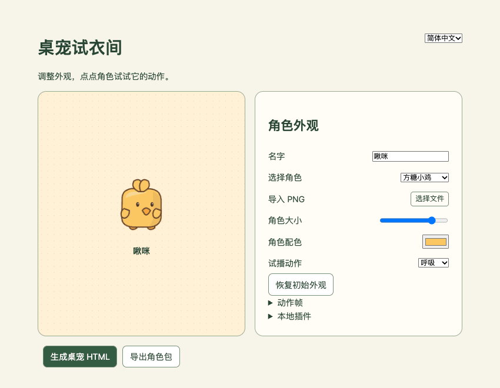

# 啾咪 · Jiumi

[English](../../README.md) · **简体中文** · [文档目录](index.zh-CN.md)

啾咪是一个轻量、可扩展的框架，让任何 Agent 都能轻松创建自定义桌面宠物。

## 告诉你的 Agent

```text
使用这个 Skill：https://github.com/r1ckypp/jiumi/tree/main/skill/jiumi-pet
给我做一只蓝色啾咪，叫泡泡。
```


## 框架特色

- **从一张图开始，定制到每个动作。** 一张透明 PNG 就能做出第一只宠物。你可以给它画两帧眨眼，让它被摸时挥挥爪子，也可以装上本地插件，为它加上新本领。形象和动作素材都可以由你自己提供。
- **用你习惯的 Agent 来做。** 把公开的 Skill 交给 ChatGPT、Claude Code、Doubao Work、Qoder Work、Workbody，或其他能按说明协作的助手，就能从熟悉的工具开始创作。做好以后，关掉助手，宠物照样运行。
- **同一只宠物，带到不同平台。** 目前可以在 macOS、Windows 和 Linux 的浏览器中打开 HTML 版，在 macOS 上还可以把它变成独立的桌面悬浮宠物。更多平台的原生支持，以及 Android、iOS 的移动体验，将逐步拓展。

## 使用本地桌宠制作器

1. 解压 Skill，在浏览器中打开 `jiumi-pet/maker.html`。如果使用源码，在仓库根目录运行下面的命令，再打开 `dist/maker.html`。

   ```sh
   python3 integrations/local/build.py
   ```

2. 在右上角的语言菜单选择「简体中文」。给方糖小鸡起个名字，或选蓝色小猪、导入自己的透明 PNG。点一下摸摸它，长按拖动，再松手看它落地。
3. 点「生成桌宠 HTML」，双击下载的文件，就能在本机浏览器里和桌宠互动。也可以点「导出角色包」，保留带有同一角色 ID、素材和动作的可编辑 JSON。



源码构建还会生成 `dist/jiumi-pet-skill.zip` 和兼容宿主可安装的 `dist/jiumi-local.zip`。[Skill 使用说明](../../skill/jiumi-pet/SKILL.zh-CN.md)

你的 Agent 负责创建桌宠，成品在本机运行。托管平台属于可选集成。

## 扩展啾咪

第一次做插件可以从专注计时器开始。在「本地插件」里导入它的 JSON。收到 `agent.started` 事件后，插件开始 25 分钟计时，截止时间随角色保存。[示例源码](../../examples/focus-timer/index.ts) · [可安装模块](../../examples/modules/focus-timer.json) · [插件 SDK](../spec/plugin-sdk.zh-CN.md)

| 如果你想…… | 从这里开始 |
| --- | --- |
| 让自己的助手制作桌宠 | [Skill 使用说明](../../skill/jiumi-pet/SKILL.zh-CN.md) |
| 接入工具、把事件映射为动作 | [事件与反馈](../spec/event-feedback.zh-CN.md) |
| 读写角色包 | [本地运行设计](../spec/offline-pet.zh-CN.md) · [JSON Schema](../spec/contracts.schema.json) |
| 构建、测试、翻译或提交改动 | [贡献指南](CONTRIBUTING.zh-CN.md) · [项目指导](AGENTS.zh-CN.md) |

## 许可证

啾咪开放核心及其文档采用 MIT 许可证。官方角色原画单独维护。使用第三方素材或插件时，请查阅它们随附的授权条款。[MIT 正式条款](../../LICENSE) · [中文参考译文](LICENSE.zh-CN.md)
